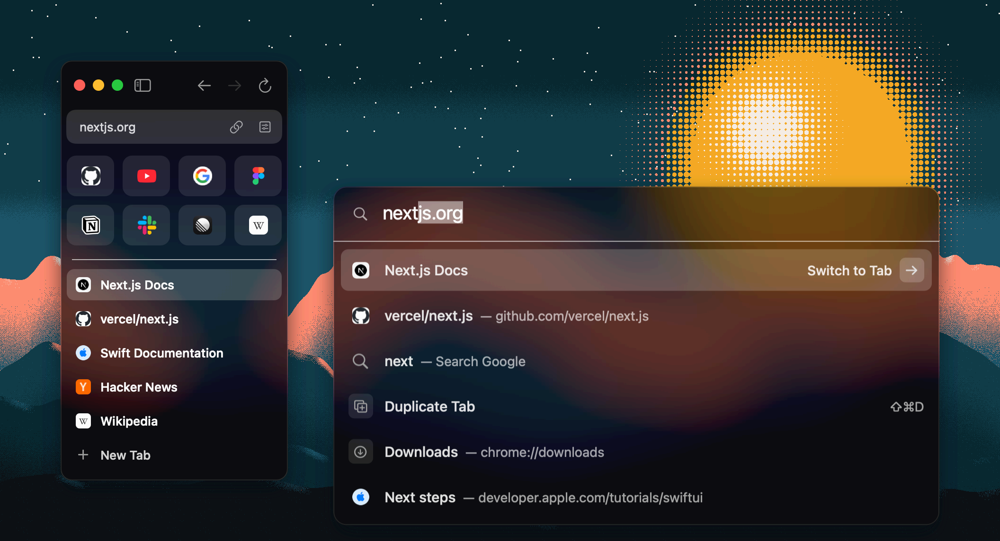
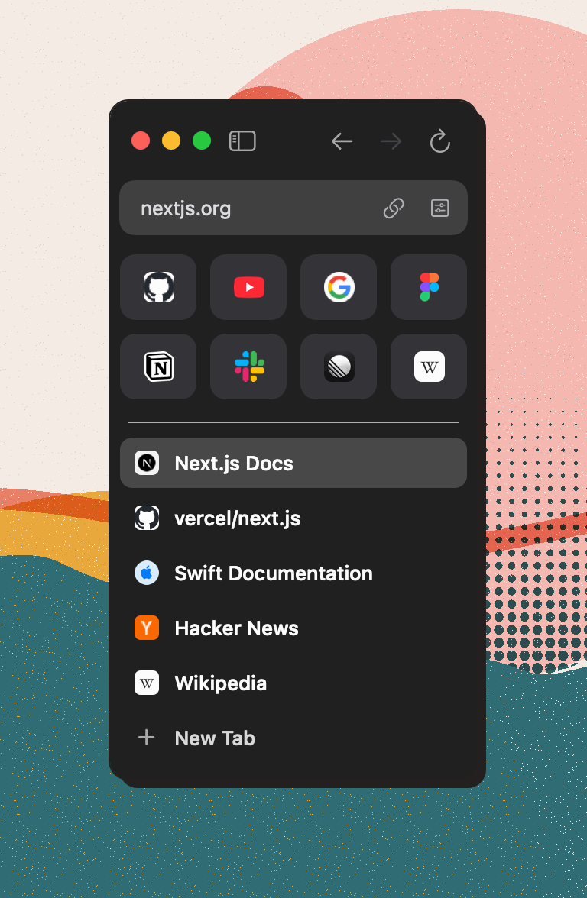
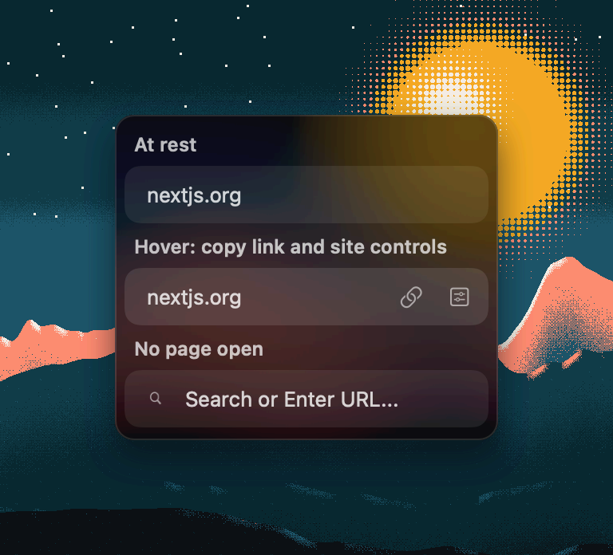
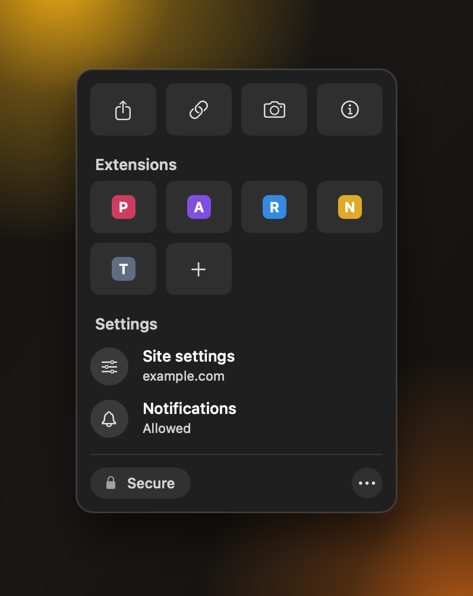
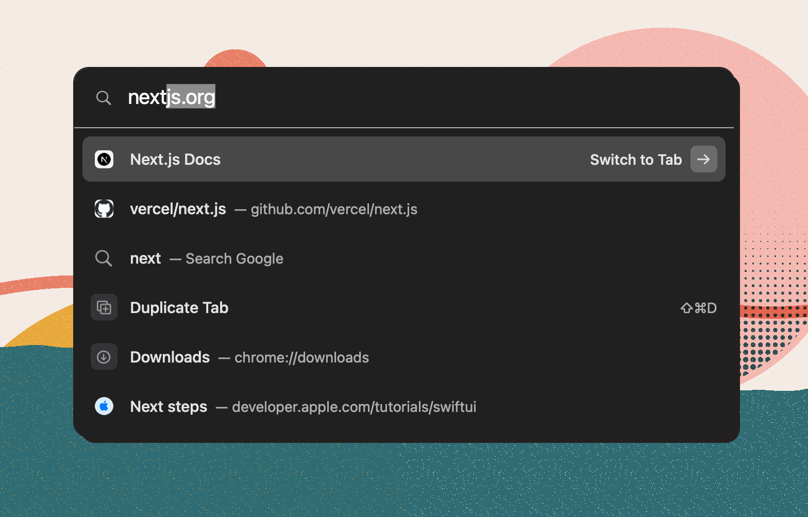
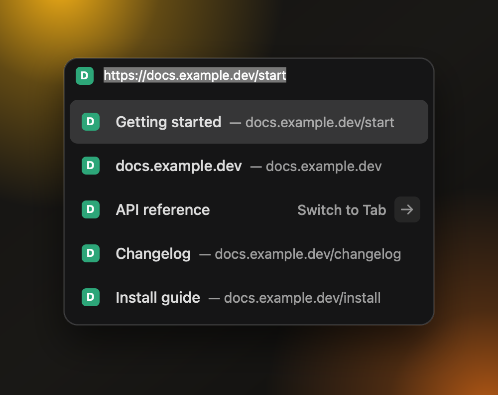

<div align="center">

# ArcPatches

**Arc's sidebar and workflow, patched into the browser you use now.**

[](https://github.com/amannhq/arcpatches/actions/workflows/ci.yml)
[](https://github.com/amannhq/arcpatches/releases)
[](LICENSE)




</div>

Arc is going away. Its successor, Dia, is fast and polished but leaves out much of what made Arc Arc.
ArcPatches brings those parts back: the URL bar in the sidebar, a full-window page, the `⌘T` command bar and Arc's shortcuts.
It does this by patching your own copy of the browser on your Mac. Nothing of the browser is downloaded or redistributed.

> [!WARNING]
> ArcPatches is unofficial and is not affiliated with or endorsed by The Browser Company.
> Patching an app may go against its terms of use. Read [Security and trade-offs](#security-and-trade-offs) before installing.

<sub>The top row, URL pill, site controls, ⌘T bar and ⌘L editor in these images are rendered from ArcPatches' own view code with demo data (`tools/screenshots/`). The window buttons, favourites and tabs around them are drawn to stand in for Dia's own sidebar.</sub>

## What you get

<table>
<tr>
<td width="50%" valign="top">

### The sidebar, Arc's way

The current site sits at the top of the sidebar.
A sidebar toggle follows the window buttons, and back, forward and reload sit at the end of the same row.
Forward dims when there's nowhere to go.
In full screen the window buttons disappear and the row starts with the toggle.

</td>
<td width="50%"></td>
</tr>
<tr>
<td width="50%"></td>
<td width="50%" valign="top">

### A URL pill that stays quiet

The pill shows just the host.
Hovering it brings up **Copy Link** and **Site Controls**, and clicking the text opens the address editor.
With no page open it reads "Search or Enter URL...".

</td>
</tr>
<tr>
<td width="50%" valign="top">

### Site controls

Share, copy the link, see site info and, where Dia offers it, take a screenshot.
Your extensions are a click away, along with the site's settings and any permission it has, such as notifications.
The footer shows whether the connection is secure.

</td>
<td width="50%"></td>
</tr>
<tr>
<td width="50%"></td>
<td width="50%" valign="top">

### `⌘T` command bar

A floating bar over the page.
It searches open tabs, history and bookmarks, runs browser commands, opens `chrome://` pages, and completes sites as you type.
A new tab is only created when you pick something.

</td>
</tr>
<tr>
<td width="50%" valign="top">

### `⌘L` address editor

`⌘L` or a click on the URL drops the editor down from the pill, with the full URL selected.
Before you type, it lists the page, the site's root, and your other tabs and history on that site.

</td>
<td width="50%"></td>
</tr>
</table>

Also included:

- **Full-window pages.** The top toolbar is hidden, so pages use the whole window. Hover the top edge to bring it back.
- **Arc shortcuts.** `⌘S` toggles the sidebar, `⌘⇧C` copies a clean URL, and `⌘⇧⌥C` copies a Markdown link. Each one can be turned off.
- **AI out of the way.** Hides chat entry points and stops the local AI agent and the on-device model process. It can optionally block AI and telemetry hosts.
- **Stays patched.** The ArcPatches app patches the browser again after each update and restores the original in one click.

Every feature can be switched off in **Settings → ArcPatches** inside the patched browser.

## Supported browsers

| Browser | Status |
| --- | --- |
| **Dia** (macOS) | ✅ Supported. Tested on 1.57.x. |
| Ardia | ⚠️ Partial: only the Chromium performance switches. Its UI is React Native, so it can't be patched like Dia's. |
| Chrome | ❌ Not supported. Its UI is drawn by Chromium's own C++ views. |
| Arc | ➖ Not a target. Arc already is Arc, and The Browser Company is retiring it. |

## Install

**Requirements:** a Mac with Apple silicon, macOS 14 or later, and Dia in `/Applications`.

```bash
curl -fsSL https://raw.githubusercontent.com/amannhq/arcpatches/main/install.sh | bash
```

The script downloads the [latest release](https://github.com/amannhq/arcpatches/releases/latest), checks its SHA-256 and the app's signature, installs ArcPatches to `/Applications` (or `~/Applications` if `/Applications` isn't writable) and opens it.
Then **quit Dia and click Patch**. If macOS asks about "Dia Safe Storage", choose **Always Allow**.

ArcPatches isn't notarized, because that needs a paid Apple developer account. Files fetched with `curl` aren't quarantined, so the script avoids the Gatekeeper prompt. It's short, so [read it](install.sh) first if you like.

<details>
<summary><b>Prefer to download it yourself?</b></summary>

1. Download `ArcPatches.zip` from the [latest release](https://github.com/amannhq/arcpatches/releases/latest), unzip it, and move `ArcPatches.app` to Applications.
2. Open it once. macOS will refuse, because the app isn't notarized.
3. Open **System Settings → Privacy & Security**, scroll down, and click **Open Anyway** next to ArcPatches. On macOS 15 and later, right-click → Open no longer gets past this.

   Or, in Terminal: `xattr -dr com.apple.quarantine /Applications/ArcPatches.app`
4. Quit Dia, open ArcPatches and click **Patch**.

</details>

By default Dia is patched in place and keeps its name and profile. The original is kept, so you can put it back at any time.
To leave the original app untouched, turn off **Patch Dia directly**. ArcPatches then builds a separate `~/Applications/Dia Arc.app`.
Use one or the other, not both, because they share a profile.

**Uninstall:** quit Dia, then choose **Uninstall ArcPatches…** from the ArcPatches menu (or the window's **Uninstall…** button), or run `/Applications/ArcPatches.app/Contents/MacOS/ArcPatches --uninstall`. That puts the original Dia back, moves a separate "Dia Arc" copy to the Trash, and removes the background job and login item. Then delete `ArcPatches.app`. To remove everything, also delete `~/Library/Application Support/arcpatches`, which holds the backup of the original Dia.

### Build from source

```bash
xcode-select --install
git clone https://github.com/amannhq/arcpatches.git
cd arcpatches
./tests/run.sh                          # tests that need no browser
./installer/build.sh --launch           # build and open the ArcPatches app
```

## How it works

```
/Applications/Dia.app ──clone──▶ pristine backup (APFS clone, no extra space)
          │
          └──▶ + arcpatches.dylib + weak load command ──re-sign──▶ patched app
                         │
                         └── at launch: hooks a few private AppKit views
                             (sidebar header, toolbar, command bar) and
                             adds the Arc-style UI next to them
```

- **Small surface.** The dylib changes the browser's own views at runtime. It doesn't patch the binary's code.
- **Fails safe.** If a browser update renames a class a feature relies on, that feature switches itself off and the health list in the app tells you which one.
- **Updates still work.** The browser's own updater stays on, and ArcPatches patches the new version after it installs.
- **Signed updates for ArcPatches.** Releases are verified with an ed25519 key held only in this repository's CI secrets.

## Security and trade-offs

- ArcPatches itself isn't notarized by Apple: that needs a paid developer account, which this project doesn't have. The install script checks the release's SHA-256 and the app's code signature instead.
- The patched app is signed ad hoc on your Mac, not by The Browser Company. Keychain items such as "Dia Safe Storage" ask once for access.
- The hardened runtime stays on. Only library validation is relaxed so that `arcpatches.dylib` can load. `DYLD_INSERT_LIBRARIES` is still blocked.
- Passkeys from Apple Passwords only work in the vendor-signed app. Use a password-manager extension, a phone (QR code), or the menu item that opens the current tabs in the original app.
- Host blocking is best effort. Use a firewall such as LuLu or Little Snitch if you need a guarantee.

Found a vulnerability? Please follow [SECURITY.md](SECURITY.md) and don't open a public issue.

## Contributing

Contributions are welcome, from bug reports to new patches.
Start with [CONTRIBUTING.md](CONTRIBUTING.md). It covers the project layout, how to find the browser view to hook, testing, and the pull request checklist.
Everyone taking part is expected to follow the [Code of Conduct](CODE_OF_CONDUCT.md).
The README images are rendered offscreen with `tools/screenshots/shots.m` and `frame.swift`. See the compile line at the top of `shots.m`.

## License

[MIT](LICENSE). Dia and Arc are trademarks of The Browser Company. They're used here only to say which browser ArcPatches works with.
